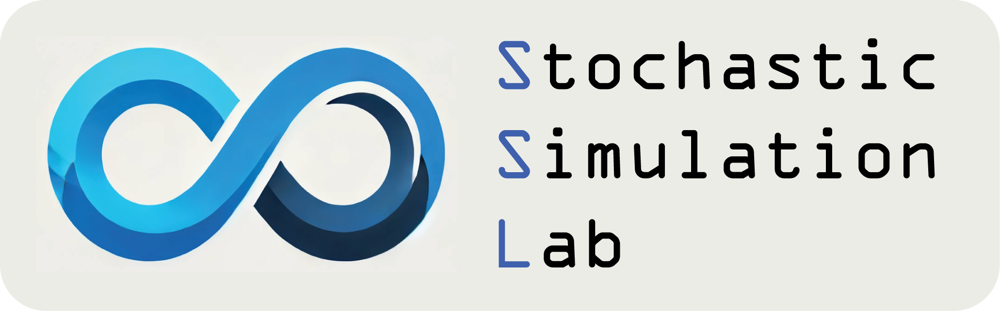

# SSL Annotation Studio



A standalone bounding box annotation tool for computer vision projects. Supports exporting to Pascal VOC, YOLO, and COCO formats.

Developed by the **Stochastic Simulation Lab (SSL)**. The application's
**Help > About** window includes development and funding credits, the funding
PI, and a clickable website link.

The native desktop interface uses teal, warm off-white, and white panels.
Noto Sans is used
when installed, with a local fallback. No website, browser, font download, or
network connection is needed for manual annotation. Optional AI Assist downloads
its model on first use, then can reuse locally cached weights.
The application deliberately uses a consistent light palette, including warning,
input, and AI dialogs, so text stays readable even when the OS uses a dark theme.

## Features

- **Three-panel layout**: Image list, annotation canvas, and class management
- **Simple workspace**: Clear Open Folder, Save, and Export Labels actions, plus an introductory empty state
- **Image browsing**: Search filenames, filter images with/without boxes, single-click to open, and jump to an image number
- **Visible progress**: Saved/unsaved/error indicators and the number of images containing boxes (not a review-approval count)
- **Readable labels**: Species names remain readable when zooming out on large images
- **Modern annotation features**: Undo/redo, multi-select, keyboard shortcuts
- **Multiple export formats**: Export VOC, YOLO, and COCO on demand
- **Auto-save**: Saves changed annotations after one second of inactivity and before navigation
- **Lightweight runtime**: Qt Essentials and Pillow; no GPU, server, or inference model required
- **Existing datasets**: Import same-stem Pascal VOC XMLs beside images
- **Cross-platform**: Works on Windows, macOS, and Linux
- **Optional AI Assist**: Text-prompted draft boxes, batch processing, and native approval/rejection; all implementation lives inside this tool

## Installation

### From Source

1. Install Python 3.9 or higher and [uv](https://docs.astral.sh/uv/).
2. From this tool's folder, install runtime dependencies:
```bash
uv sync
```

3. Run the application:
```bash
uv run python main.py
```

### Standalone Executable

Build a standalone executable that runs without Python:

```bash
uv run --group build python build.py
```

The manual executable is created in `dist/SSLAnnotationStudio` (`.exe` on Windows,
`.app` on macOS). AI libraries are excluded from this lightweight edition.

To build the AI-enabled edition with your installed PyTorch runtime:

```bash
uv run --extra ai --group build python build.py --ai
```

This creates `dist/SSLAnnotationStudio-AI/` on Windows/Linux, or
`dist/SSLAnnotationStudio-AI.app` on macOS. Distribute the **entire** folder or app,
including its bundled libraries, not just the inner executable. AI uses a folder
bundle so large model libraries do not have to be extracted on each worker
launch. Model weights are not embedded: first use downloads them into the user's
Hugging Face cache. Internet access and writable cache storage are required for
that first run. A local AI build uses the CPU/CUDA capabilities of the installed
PyTorch package; it is much larger than the manual edition.

### GitHub Actions Builds

`.github/workflows/build.yml` creates both **manual** and **ai** editions on
Windows, Linux, and macOS, triggered by a `v*` tag or a manual workflow run.
The downloadable artifact names include the edition, OS, and runner architecture:
`SSLAnnotationStudio-manual-...` and `SSLAnnotationStudio-ai-...`.

The GitHub AI builds use CPU PyTorch (2.10.0) with Torchvision (0.25.0) and
Transformers (4.57.6); they do not require an NVIDIA GPU or CUDA driver. Use
`auto` or `cpu` in these builds. For GPU inference, use the source environment
with compatible CUDA PyTorch, or create a local AI build from that environment.

Each job runs source tests, checks the actual packaged GUI and icon assets,
and, for AI, runs real CPU inference through the packaged worker before uploading.
The AI check downloads model weights on the CI runner; those weights are not
included in the download. Windows downloads contain a zip; Linux/macOS contain
a tar.gz preserving executable permissions and macOS framework symlinks. Extract
the inner archive fully before launching. Artifacts are retained for 30 days.
The applications are not signed/notarized, so OS security warnings may appear.

When this folder is its own repository, the workflow is already in the correct
location. In a repository containing this tool as a subfolder, copy the workflow
to the repository-root `.github/workflows/` directory so GitHub discovers it;
it detects either source layout automatically. Builds are native to each runner,
not cross-compiled. Windows/macOS builds must be verified by their CI jobs.

To perform the same bundle check and create an archive locally:

```bash
uv run --extra ai --group build python tests/check_bundle.py --edition ai
```

## Usage

1. **Open a folder**: Click Open Folder to select images; existing sidecar VOC labels are imported for a new project.
2. **Choose a label**: Use Add Label if needed, then choose the Active label dropdown on the right.
3. **Draw boxes**: Select Draw Box (B) and drag around an object. New boxes use the active label and are selected automatically.
4. **Adjust**: Select (S) lets you move or resize boxes. Change the selected boxes' label using the dropdown, number keys (0-9), or a label double-click. With no box selected, these choose the label for the next box instead of changing earlier boxes.
5. **Browse**: Search filenames or choose All images, Without boxes, or With boxes. Single-click an image or use Previous/Next (A/D or arrows); navigation follows the current filter. Go to and Home/End can open any image and clear filters if necessary.
6. **Save and export**: Edits autosave after a short pause and before navigation. Save (Ctrl+S) saves immediately; Export Labels (Ctrl+Shift+E) generates the training files.

The left progress bar counts images containing at least one box; it does not
mean that annotations were reviewed or approved. Hover over an image name to
see its filename and box count. Drag the panel dividers to adjust workspace size.

To correct a misspelled label, select it in the Labels list and click **Rename
Label...**. If no list label is selected, the active dropdown label is used.
This updates that label on every image, preserves its color and box coordinates,
and rejects blank or duplicate names. AI-approved images using it need approval
again. To change only a particular box to another existing label, select the
box and choose the Active label dropdown instead. Export again after renaming
to refresh training files.

Exports are now explicit: autosaving and browsing no longer regenerate the
entire dataset in three formats. `project.json` remains the authoritative
working state. Export again after editing to update training labels.

## AI-Assisted Annotation

Everything needed for AI assistance lives in `Annotation_GUI_Tool`. You can copy
this folder to another machine without `labeling_pipeline`, the training project,
trained insect checkpoints, or the original datasets. Install the optional
dependencies **from this folder**:

```bash
uv sync --extra ai
uv run --extra ai python main.py
```

Use `--extra ai` when launching to ensure the optional dependencies are installed.
Once installed, the existing run scripts also support AI Assist. Running
`uv sync` without `--extra ai` removes the optional packages; manual annotation
still works. Python 3.11 is recommended for
AI on a new installation (`uv sync --python 3.11 --extra ai`, then
`uv run --python 3.11 --extra ai python main.py`). The existing Python 3.9
environment also supports the resolved compatible dependency versions.

1. Open a folder of images and create/select the species label under Labels.
2. Choose **AI Assist...** in the right panel or **AI > Generate Drafts**.
3. Select **Current image** or **All unannotated, unprocessed images**. Existing boxes are never replaced. The batch scope covers the whole open folder, not just the filename filter.
4. Choose the species label and enter a visual description, such as `a moth; an adult moth`. Semicolons separate prompts. Descriptions localize objects; species names alone may work poorly.
5. Choose `auto` (first available CUDA GPU, otherwise CPU), `cpu`, `cuda:0`, or `cuda:1`. The default box-confidence threshold is 0.35; text threshold is 0.25 and NMS overlap threshold is 0.5. Confidence is a model heuristic, not verified accuracy.
6. Click **Generate Drafts**. Progress and errors appear in the dialog. Successful generation automatically returns to the canvas; you do not need to click Stop. Completion is shown immediately, even if the AI framework takes time to shut down. If errors occur, the dialog stays open so you can read them, then choose **Review Drafts** or **Close**. **Stop** is only for canceling a run and retains completed drafts while leaving unfinished images unchanged.
7. Review every box in the normal canvas. Draw missing boxes, delete false positives, resize, move, or change labels as needed. Then choose **Approve** or **Reject**. Use **Needs AI review**, **AI approved**, and **AI rejected** filters to browse decisions.
8. Choose **Export Labels**. Only approved AI images are exported; manual annotations keep their normal export behavior.

The worker uses [Grounding DINO Tiny](https://huggingface.co/IDEA-Research/grounding-dino-tiny)
with Transformers, PyTorch, and Torchvision. First use needs internet access for
the weights and processor; later runs use the local model cache. Images are
processed locally, not uploaded. Each run loads the model once, processes the
selection, and releases its memory when the worker exits. CPU inference can be
slow. CUDA drivers and the selected PyTorch build must be compatible.

### Review Safety

- Every generated image starts **pending**, including images with no detections. No detections does not mean a verified negative. Add/correct a box before approval, or reject an unsuitable image.
- AI does not establish species identity or reliably exclude life stages. The chosen label is applied to all proposals; inspect for other species, caterpillars, missed objects, and duplicate boxes.
- **Reject** preserves the source image and its working boxes for reference. It does not delete files. **AI > Reset Current Review** returns a decision to pending.
- Editing boxes or labels invalidates approval. Approval covers the exact annotation state and source image checksum. A changed source is excluded from export; clear its old boxes and regenerate its draft if necessary.
- VOC and YOLO files for pending/rejected AI images are omitted or removed on re-export; COCO excludes those images completely so they are not treated as background negatives. Original sidecar XMLs remain untouched.
- Review decisions, original proposals/scores, prompts, model revision, generation time, EXIF orientation, and source checksums are stored in `project.json`, alongside editable annotations. No separate HTML export/import step is needed.
- Original decoded-pixel coordinates are used, without EXIF autorotation. Orientation flags appear in the generation log for review.
- Applying a draft to the current image is undoable as one operation. As with manual annotation, undo history is local to the current image; batch results on other images are reviewed/edited individually.

If AI dependencies are missing, the GUI shows the installation commands. Errors
such as an unavailable GPU, a failed download, or a corrupt image appear in the
log without replacing existing annotations. Manual mode remains available.

## Keyboard Shortcuts

- **Navigation**: ←/→ or A/D (previous/next image), Home/End (first/last)
- **Tools**: S (Select), B (Box), H (Pan)
- **Box Operations**: Delete (remove box), Ctrl+A (select all), Escape (deselect)
- **Class Assignment**: 1-9, 0 (assign class by number)
- **Zoom**: Ctrl+Mouse Wheel, Ctrl+0 (fit), Ctrl+1 (100%)
- **General**: Ctrl+Z (undo), Ctrl+Y (redo), Ctrl+S (save), Ctrl+Shift+E (export)

## Project Structure

New projects save inside the selected image folder, keeping sibling projects
separate. The application creates:
- `project.json` - Working state with all annotations
- `project.json.bak` - Backup of previous save
- `exports/` - Generated when Export Labels is requested:
  - `voc/Annotations/*.xml` - Pascal VOC format
  - `coco/annotations.json` - COCO format
  - `yolo/labels/*.txt` + `classes.txt` - YOLO format

An older parent-directory `project.json` is still recognized if its stored
`image_folder` matches the selected folder, retaining that project's original
save/export locations. Saved projects take priority over stale imports,
including images where all boxes were intentionally deleted. Source images and
original sidecar XMLs are preserved; exports do not overwrite the sidecars.

Project writes use temporary files and atomic replacement. A prior successful
save is kept as a backup. Save failures are reported and block navigation;
closing after a failure requires an explicit discard choice.

## Responsiveness And Reliability

- Unchanged projects are not rewritten when browsing.
- Autosave is debounced rather than writing on every mouse movement.
- Only the current image is decoded; undo/redo reuse its pixmap while its file is unchanged.
- Image discovery uses one directory scan and supports mixed-case extensions.
- Undo history is bounded and isolated to the current image.
- Renaming a class updates its existing annotation labels.
- Drawing a box creates one annotation, and clicks without dragging create none.
- Re-exporting removes stale VOC/YOLO labels for images whose boxes were cleared.
- The window has resizable panels and supports smaller screens.

## Tests

Run the offscreen regression suite from this folder:

```bash
uv run python -m unittest discover -s tests -v
```

Tests use temporary folders and do not edit real image datasets. They cover
autosave, unchanged navigation, save failures, backup recovery, sidecar imports,
box coordinates, undo/redo, and deleted annotations staying deleted.
AI unit tests use a fake detector and cover approval gates in all export formats,
source validation, edits reopening review, cancellation, and persistence.

An optional real-model smoke test copies an adult-moth image into a temporary
folder, runs the GUI worker, approves its result, and checks a VOC export:

```bash
AI_SMOKE_IMAGE=/absolute/path/to/moth.jpg uv run --extra ai python -m unittest discover -s tests -p test_ai_integration.py -v
```

Without `AI_SMOKE_IMAGE`, this test is skipped. Source datasets are never changed.

## For more details, check [QUICKSTART.md](QUICKSTART.md)

## Requirements

- Python 3.9+
- PySide6-Essentials (provides the `PySide6` imports)
- Pillow
- PyInstaller is optional, installed through `uv run --group build` only when building
- Optional AI: PyTorch, Torchvision, Transformers; install with `uv sync --extra ai`

For pip installations, `pip install -r requirements.txt` installs runtime
dependencies. Add `pyinstaller` separately to build an executable.

## License

MIT License

## Funding

This project was developed with funding support from the United States Department of Agriculture (USDA).

**Funding PI:** Syed Hasib Akhter Faruqui.

**Website:** [www.shafnehal.com](https://www.shafnehal.com/).
